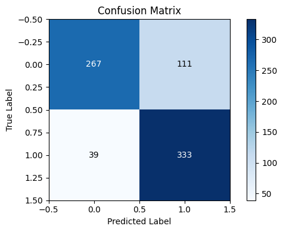
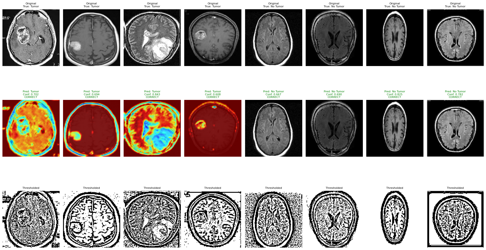
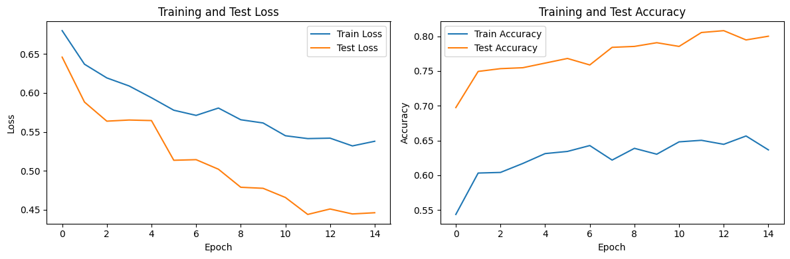

# Brain Tumor Detection in MRI with a CNN and Grad-CAM

A small, deliberately regularised CNN (PyTorch) that classifies brain MRI slices as **tumor** or
**no tumor**, with Grad-CAM heatmaps to show which regions drove each prediction.

## Results

Held-out test set of **750 images** (25% of the data, stratified, never seen in training):

| Class | Precision | Recall | F1 | Support |
|---|---|---|---|---|
| No tumor | 0.87 | 0.71 | 0.78 | 378 |
| Tumor | 0.75 | **0.90** | 0.82 | 372 |
| **Accuracy** | | | **0.80** | 750 |

Confusion matrix: 333 tumors found, 39 missed; 267 healthy scans correct, 111 false alarms.
The model is tuned towards **recall on tumors** (missing a tumor is worse than a false alarm),
at the cost of more false positives.



### Grad-CAM examples

Top row: original slices. Middle row: Grad-CAM overlay and prediction with confidence. Bottom row:
thresholded image. On some tumors the heatmap concentrates on the lesion; on others it is spread
across the whole brain, which is expected from a small CNN trained with image-level labels only.



### Training curves



Test accuracy is higher than training accuracy throughout. This comes from the heavy regularisation
used on purpose: dropout of 0.7 and random flips are active during training and switched off at
evaluation time. Mean confidence is 0.73 on correct predictions and 0.59 on wrong ones.

## Data

- 3,000 grayscale MRI slices: 1,500 with a tumor (`yes/`) and 1,500 without (`no/`)
- Image-level labels only, no pixel masks
- Resized and normalised; split 75% train (2,250) / 25% test (750) with a fixed random seed

## Method

1. **Model**: two convolution layers (4 and 8 filters), max pooling, dropout 0.7, a 16-unit dense
   layer and a 2-class output. Small on purpose, to limit overfitting on 2,250 training images.
2. **Augmentation**: random horizontal and vertical flips, training set only.
3. **Training**: 15 epochs, batch size 8, CPU.
4. **Evaluation**: confusion matrix, per-class precision/recall/F1, and a confidence analysis.
5. **Explanation**: Grad-CAM on the last convolution layer, overlaid on each sample.

## Run it

```bash
pip install -r requirements.txt
jupyter notebook brain_tumor_classifier.ipynb
```

Run all cells. The notebook expects the `yes/` and `no/` folders next to it, prints the metrics
above, draws the figures, and saves the weights as `brain_tumor_classifier.pth` (git-ignored).

## Repository layout

```
brain-tumor-detection/
├── brain_tumor_classifier.ipynb   # full pipeline: data, model, training, evaluation, Grad-CAM
├── yes/                           # MRI slices with a tumor (1,500)
├── no/                            # MRI slices without a tumor (1,500)
├── images/                        # figures used in this README
├── REPORT.md                      # short project report
└── requirements.txt
```

## Limitations

- Image-level labels only: Grad-CAM is a visual explanation, not a segmentation of the tumor.
- 111 false alarms out of 378 healthy scans; a larger model or transfer learning from a pretrained
  backbone would likely raise precision.
- Single random split; no cross-validation or external test set.
